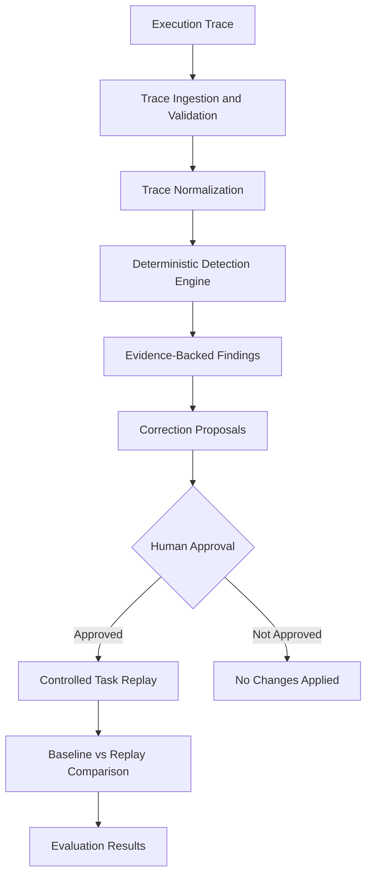

# TraceMind AI

### Observe. Diagnose. Repair. Verify.

**An AI-agent debugging and reliability platform that turns execution traces into evidence-backed diagnoses, controlled repairs, and measurable evaluations.**

TraceMind AI analyzes tool-using agent execution traces to identify suspicious behavior, explain failures with trace evidence, propose corrective configuration changes, and evaluate those changes through controlled task replay.

Rather than treating an agent's final answer as proof of success, TraceMind examines the execution that produced it.

<p align="center">
  
  
  
  
</p>

> **Project status:** Backend and benchmark implementation complete; frontend in progress. The benchmark contains 28 hand-labelled scenarios. Results are preliminary and should not be interpreted as evidence of general reliability.

---

## Table of Contents

* [Why TraceMind?](#why-tracemind)
* [Core Capabilities](#core-capabilities)
* [Architecture](#architecture)
* [Failure Detection](#failure-detection)
* [Controlled Replay and Repair](#controlled-replay-and-repair)
* [Benchmark and Evaluation](#benchmark-and-evaluation)
* [Quick Start](#quick-start)
* [API Reference](#api-reference)
* [Project Structure](#project-structure)
* [Deployment](#deployment)
* [Limitations](#limitations)
* [Roadmap](#roadmap)
* [Contributing](#contributing)

---

## Why TraceMind?

Tool-using AI agents can fail in ways that are difficult to identify from their final responses alone.

An agent might:

* Repeat the same unsuccessful tool call without making progress.
* Encounter a tool error and continue as though the operation succeeded.
* Claim a task is complete despite an unsuccessful execution.
* Skip a required step or violate an expected action sequence.
* Produce a result that conflicts with the evidence in its trace.

Traditional success/failure checks can miss these problems because a response may appear convincing even when its execution was unreliable.

**TraceMind focuses on execution-level evidence.** It analyzes recorded events, identifies suspicious behavior, links findings to evidence, and supports controlled evaluation of proposed fixes.

### Design principles

* **Evidence first:** Findings reference relevant trace events.
* **Deterministic detection:** Implemented rules produce reproducible results for the same inputs.
* **Controlled changes:** Proposed corrections are not applied automatically.
* **Approval-gated replay:** Re-execution requires explicit approval of the proposed changes.
* **Measured outcomes:** Baseline and replay runs can be compared.
* **Transparent evaluation:** Benchmark results include false positives, false negatives, and methodological limitations.

---

## Core Capabilities

| Capability               | Description                                                                   |
| ------------------------ | ----------------------------------------------------------------------------- |
| Trace ingestion          | Accept and validate execution traces through the API                          |
| Failure detection        | Run deterministic detectors over recorded events                              |
| Evidence-backed findings | Associate findings with relevant event IDs                                    |
| Failure diagnosis        | Generate proposed configuration corrections                                   |
| Controlled execution     | Run tasks using deterministic workflows and mock tools                        |
| SQLite persistence       | Store traces, runs, and associated results                                    |
| Approval-gated replay    | Rerun tasks with explicitly approved configuration changes                    |
| Before/after comparison  | Compare task outcomes, tool-call counts, and simulated durations              |
| Benchmark evaluation     | Calculate precision, recall, false-positive rate, and confusion-matrix counts |
| Regression checks        | Evaluate whether proposed changes fix failures without breaking other tasks   |

---

## Architecture

TraceMind follows a trace-analysis and controlled-repair workflow.



### System components

**1. Trace ingestion and normalization**

Receives trace data, validates the input, and normalizes recorded execution events for downstream analysis.

**2. Detection engine**

Runs deterministic rules against the normalized trace and produces findings with supporting evidence.

**3. Diagnosis and correction proposals**

Maps findings to proposed configuration changes. Proposals are recommendations rather than automatic modifications.

**4. Controlled task runner**

Executes predefined tasks through in-process mock tools. Its behavior is determined by the task definition and `RunConfig`.

**5. Replay and comparison**

Replays a task using an approved configuration and compares the result with its baseline execution.

**6. Benchmark and evaluation**

Evaluates detector behavior against labelled scenarios and measures the effect of configuration changes on the controlled runner.

### Technology stack

* **Language:** Python
* **Backend API:** FastAPI
* **Persistence:** SQLite
* **Testing:** pytest
* **Evaluation:** Custom benchmark and deterministic task runner
* **Deployment:** Docker and Render
* **Frontend:** Planned React interface, with Vercel deployment configured

The runner uses deterministic mock tools rather than a live LLM agent. Simulated durations are useful for controlled comparisons but do not represent real-world latency.

---

## Failure Detection

TraceMind implements six detectors. Three focus on general execution-trace patterns; the remaining three depend on additional task or trace configuration.

| Detector                           | What it identifies                                                                                 |
| ---------------------------------- | -------------------------------------------------------------------------------------------------- |
| `repeated_call_no_progress`        | Three or more consecutive calls with equivalent inputs and results                                 |
| `explicit_tool_error`              | Tool calls containing recorded error details                                                       |
| `unsupported_completion_claim`     | A completion claim unsupported by the final tool outcome, or certain empty-data execution patterns |
| Missing required steps             | Required steps that are absent from the trace                                                      |
| Invalid action sequences           | Recorded actions that violate configured sequence rules                                            |
| Evidence/constraint contradictions | Findings based on conflicts with declared trace constraints                                        |

### How detection works

**Repeated calls without progress**

The detector looks for at least three consecutive calls with equivalent inputs and results.

It is designed not to flag several legitimate cases, including changed inputs, changed results, interleaved calls, and allow-listed tools.

**Explicit tool errors**

Calls containing `error_details` are flagged. Severity depends on whether a later call to the same tool succeeds:

* `LOW` when a later call succeeds.
* `HIGH` when no later successful call is found.

**Unsupported completion claims**

The detector looks for completion claims that conflict with the last tool call's failure, along with certain empty-data-flow patterns.

**Configuration-dependent checks**

Missing-step, invalid-sequence, and contradiction detection depend on the corresponding `required_steps`, `sequence_rules`, and `constraints` declarations in the trace's `initial_configuration`.

> These are deterministic heuristics, not a general solution to AI-agent failure detection. Their coverage is limited by the information available in a trace and the rules implemented.

---

## Controlled Replay and Repair

TraceMind separates identifying a failure from changing the behavior that caused it.

### Workflow

1. Run a predefined task using its baseline configuration.
2. Store the execution run and trace.
3. Analyze the trace and inspect the findings.
4. Retrieve proposed configuration corrections.
5. Review and explicitly approve the proposed changes.
6. Replay the same task using the approved configuration.
7. Compare the baseline and replay outcomes.
8. Check whether the failure was resolved and whether the task regressed.

### What can be measured?

The controlled runner records information such as:

* Task completion outcome
* Tool-call count
* Simulated execution duration
* Findings associated with the run
* Baseline-versus-replay differences

A correction is marked `fix_verified` only when a replay eliminates the relevant failure category and the task does not regress. Otherwise, the correction is marked `fix_not_effective`.

The runner currently uses three runnable tasks. Its results demonstrate behavior within this controlled environment, not general improvement across arbitrary AI agents.

---

## Benchmark and Evaluation

TraceMind includes a reproducible benchmark of **28 hand-labelled execution-trace scenarios**.

The benchmark evaluates detector behavior against manually assigned failure categories and evidence events.

### Evaluation methodology

| Property                         | Description                            |
| -------------------------------- | -------------------------------------- |
| Total scenarios                  | 28                                     |
| Development scenarios            | 18                                     |
| Held-out scenarios               | 10                                     |
| Failure categories               | 6                                      |
| Labelled scenario-category cells | 168                                    |
| Scenario source                  | Hand-written synthetic traces          |
| Evaluation unit                  | One scenario-category cell             |
| Primary metrics                  | Precision, recall, false-positive rate |
| Evidence metric                  | Evidence hit rate on true positives    |

The development scenarios were used while designing the rules. The held-out scenarios were written after the detector code was frozen, but they were created by the same team and are not an independent or blind evaluation.

### Reported results

The following values are from the project's saved benchmark results.

| Split       | Scenarios | TP | FP |  TN | FN | Precision | Recall |   FPR |
| ----------- | --------: | -: | -: | --: | -: | --------: | -----: | ----: |
| Development |        18 | 15 |  0 |  93 |  0 |     1.000 |  1.000 | 0.000 |
| Held-out    |        10 |  6 |  1 |  51 |  2 |     0.857 |  0.750 | 0.019 |
| Overall     |        28 | 21 |  1 | 144 |  2 |     0.955 |  0.913 | 0.007 |

**Additional reported observations**

* Held-out precision: **85.7%**
* Held-out recall: **75.0%**
* Overall evidence hit rate on true positives: **100%**
* Clean held-out scenarios flagged: **1 out of 10**

The evidence hit rate measures whether findings cover the manually labelled evidence events for true-positive detections. It does not establish that every finding is a complete or correct explanation.

### How to reproduce the benchmark

From the repository root:

```powershell
cd backend
python -m app.evaluation.run_benchmark
```

To refresh the saved benchmark results:

```powershell
python -m app.evaluation.run_benchmark --write
```

The API also exposes live benchmark metrics at `GET /api/benchmark` and saved results at `GET /api/benchmark/saved`.

### Controlled-runner results

The saved full-fix sweep reports the following changes across the three runnable tasks:

| Metric          | Baseline | Proposed configuration |
| --------------- | -------: | ---------------------: |
| Completion rate |    0.667 |                  1.000 |
| Tool calls      |        9 |                      8 |

The `refund_empty_search` task was fixed, and no regressions were recorded in that sweep.

These results come from deterministic mock tools with simulated durations. They are specific to the current tasks and configurations.

### Known benchmark errors

The held-out benchmark intentionally retains known failures:

* **H07 — False negative:** Alternating identical calls (`A, B, A, B, ...`) can form a loop, but the repeated-call detector only examines consecutive calls.
* **H08 — False negative:** A tool can fail inside its output without `error_details`; the current completion detector does not catch every such case.
* **H09 — False positive:** An empty optional argument after an empty search is legitimate in this scenario but is flagged by the empty-data-flow rule.

Keeping these cases visible makes the benchmark useful for identifying limitations instead of presenting only favorable results.

### Interpreting the results

The development scores are not evidence of generalization because the rules were designed alongside those scenarios.

The held-out results are more informative, but the evaluation still has substantial limitations:

* Only 10 held-out scenarios.
* Synthetic, short traces rather than diverse production executions.
* Manually assigned labels from the same team that implemented the detectors.
* No independent or blind test set.
* Corrective-change effects measured on only three runnable tasks.

The results should be treated as **preliminary measurements of a small, controlled benchmark**, not as validated production performance.

---

## Quick Start

### Prerequisites

* Python 3.10–3.12
* Git
* PowerShell on Windows, or a compatible Unix shell

### 1. Clone the repository

```bash
git clone https://github.com/PeerAhammad/Tracemind-AI.git
cd Tracemind-AI
```

### 2. Create and activate a virtual environment

**Windows PowerShell**

```powershell
cd backend
python -m venv .venv
.\.venv\Scripts\Activate.ps1
```

**Linux or macOS**

```bash
cd backend
python -m venv .venv
source .venv/bin/activate
```

### 3. Install dependencies

```bash
pip install -r requirements.txt
```

### 4. Run the test suite

```bash
pytest -q
```

The project documentation reports **63 tests**. Run the suite locally to verify the current checkout.

### 5. Start the API server

```bash
uvicorn app.main:app --reload
```

Once the server starts, open:

* Interactive API documentation: `http://localhost:8000/docs`
* Alternative API documentation: `http://localhost:8000/redoc`
* Health endpoint: `http://localhost:8000/api/health`

No LLM API key is required for the implemented rule-based detectors and mock runner.

---

## API Reference

The backend exposes endpoints for traces, analysis, controlled runs, corrections, replay, and evaluation.

### Health and traces

| Method | Endpoint                    | Purpose                      |
| ------ | --------------------------- | ---------------------------- |
| `GET`  | `/api/health`               | Check service health         |
| `POST` | `/api/traces`               | Upload a trace               |
| `GET`  | `/api/traces/{id}`          | Retrieve a trace             |
| `POST` | `/api/traces/{id}/analyze`  | Analyze a trace              |
| `GET`  | `/api/traces/{id}/findings` | Retrieve the latest findings |

Trace uploads accept the documented input formats and enforce the configured `MAX_UPLOAD_BYTES` limit.

### Controlled execution and replay

| Method | Endpoint                     | Purpose                                                  |
| ------ | ---------------------------- | -------------------------------------------------------- |
| `GET`  | `/api/tasks`                 | List controlled tasks                                    |
| `POST` | `/api/tasks/run`             | Execute a task and store its run                         |
| `POST` | `/api/tasks/evaluate`        | Compare tasks under default and candidate configurations |
| `GET`  | `/api/runs/{id}`             | Retrieve run details                                     |
| `POST` | `/api/runs/{id}/analyze`     | Analyze a run's trace                                    |
| `GET`  | `/api/runs/{id}/corrections` | Retrieve proposed configuration changes                  |
| `POST` | `/api/runs/{id}/replay`      | Replay a task with approved changes                      |
| `GET`  | `/api/runs/{id}/comparison`  | Compare baseline and replay runs                         |

Replay requests require explicit approval information in the request body:

```json
{
  "approved": true,
  "approved_changes": {}
}
```

Replace the empty object with the approved changes required by the selected correction. Consult the interactive API documentation for the current request schema.

### Benchmark

| Method | Endpoint                             | Purpose                          |
| ------ | ------------------------------------ | -------------------------------- |
| `GET`  | `/api/benchmark`                     | Calculate live benchmark metrics |
| `GET`  | `/api/benchmark/saved`               | Retrieve saved benchmark results |
| `GET`  | `/api/benchmark/scenarios`           | List benchmark scenarios         |
| `GET`  | `/api/benchmark/scenarios/{id}`      | Retrieve a scenario              |
| `POST` | `/api/benchmark/scenarios/{id}/load` | Load a scenario                  |

Example requests and responses are available in [`docs/api_examples/`](docs/api_examples/).

For the authoritative schemas and response models, use the running API's Swagger documentation at `/docs`.

---

## Project Structure

```text
Tracemind-AI/
├── backend/
│   ├── app/
│   │   ├── api/                 # HTTP endpoints
│   │   ├── detectors/           # Failure detection rules
│   │   ├── diagnosis/           # Correction proposals
│   │   ├── evaluation/          # Benchmark and evaluation logic
│   │   ├── runner/              # Controlled task execution
│   │   ├── schemas/             # Data models
│   │   ├── trace_processor/     # Trace normalization
│   │   ├── main.py              # Application entry point
│   │   └── storage.py           # Persistence
│   ├── scripts/                 # Development utilities
│   ├── tests/                   # Automated tests
│   ├── requirements.txt
│   └── pytest.ini
├── benchmarks/
│   ├── fixtures/                # Trace fixtures
│   ├── scenarios/               # Labelled evaluation scenarios
│   ├── tasks/                   # Controlled runner tasks
│   └── generate_scenarios.py
├── docs/
│   ├── api_examples/            # Example API requests and responses
│   ├── architecture.md
│   └── HANDOFF.md                # Deployment and demo guide
├── frontend/                    # Frontend work in progress
├── Dockerfile
├── render.yaml
├── .dockerignore
├── .env.example
└── README.md
```

---

## Deployment

The repository includes configuration for backend deployment with Docker and Render, and a planned React frontend deployment on Vercel.

### Backend

Deployment configuration:

* `Dockerfile`
* `render.yaml`

### Frontend

The planned frontend uses `frontend/` and is configured for a Vercel deployment workflow. The documented frontend API environment variable is `VITE_API_URL`.

### Environment configuration

Configure `CORS_ORIGINS` on the backend to allow the deployed frontend's origin.

See [`docs/HANDOFF.md`](docs/HANDOFF.md) for deployment steps, free-tier considerations, API-to-page mapping, the demo script, and the deployment checklist.

**Live links**

* Frontend: Not deployed yet
* Backend/API documentation: Not deployed yet
* Demo video: Not available yet

These links should be updated when the deployments and recording are complete.

---

## Limitations

TraceMind is an early-stage research and engineering project. Its current implementation has important constraints:

1. **Limited benchmark size:** 28 synthetic scenarios are insufficient to establish broad detector reliability.
2. **Potential evaluation bias:** The team authored the scenarios and the detectors; the held-out set is not independent.
3. **Heuristic-based detection:** Rules cover specific patterns and can miss failures outside those patterns.
4. **Configuration-dependent checks:** Some detectors require declared steps, sequences, or constraints.
5. **Limited replay coverage:** Corrective effects are evaluated on three runnable tasks.
6. **Simulated execution:** Mock tools provide controlled behavior, not production latency or real-world tool reliability.
7. **No token accounting:** Token usage is not measured by the current runner.
8. **Frontend incomplete:** The interactive product interface remains in progress.

These limitations define the next evaluation and development priorities.

---

## Roadmap

* [x] Trace ingestion and validation
* [x] Deterministic failure detectors
* [x] Evidence-backed findings
* [x] SQLite persistence
* [x] Controlled task runner
* [x] Correction proposals
* [x] Approval-gated replay
* [x] Before/after comparison
* [x] Labelled benchmark and evaluation metrics
* [ ] Complete the React frontend
* [ ] Integrate the frontend with the backend API
* [ ] Deploy the frontend and backend
* [ ] Record an end-to-end demonstration
* [ ] Expand the benchmark with more diverse traces
* [ ] Evaluate against independently authored scenarios
* [ ] Test on real execution traces and broaden failure coverage

---

## Team Contributions

**AI and evaluation**

* Trace schema and normalization
* Six deterministic detectors
* Controlled runner and replay workflow
* Correction proposals and comparison logic
* Benchmark scenarios, evaluation metrics, and backend tests
* Deployment configuration

**Product and frontend**

* React interface
* Backend integration
* Frontend deployment
* Demonstration video

---

## Contributing

Contributions that improve detector coverage, evaluation quality, trace normalization, replay safety, and frontend usability are welcome.

When extending the benchmark, include representative positive and negative cases. Document expected behavior and preserve reproducibility so that improvements can be evaluated alongside regressions.

---

## License

Check the repository's license file before reusing or redistributing this project. If no license has been added, the project does not yet specify an open-source license.

---

<p align="center">
  <strong>TraceMind AI</strong><br>
  Making AI-agent failures observable, diagnosable, and measurable.
</p>
